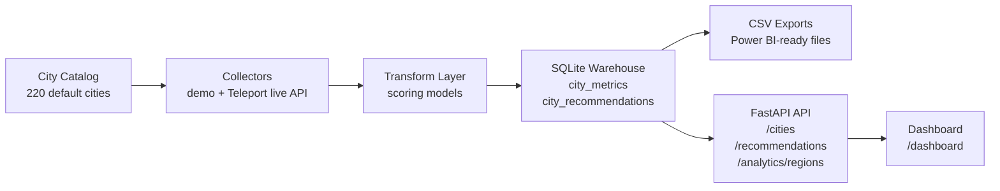
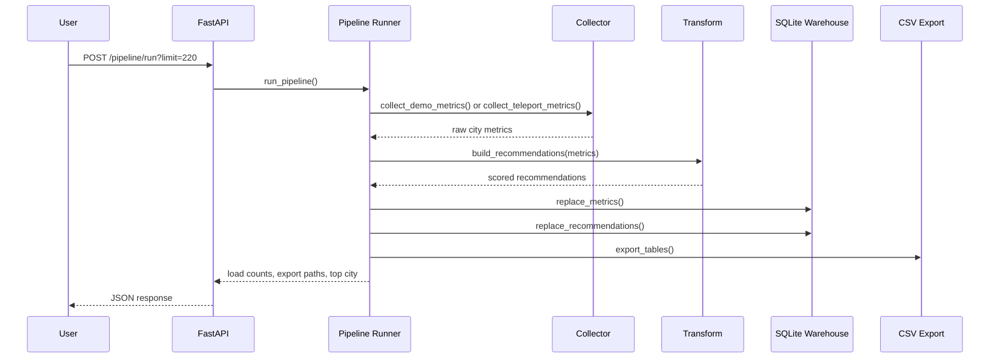
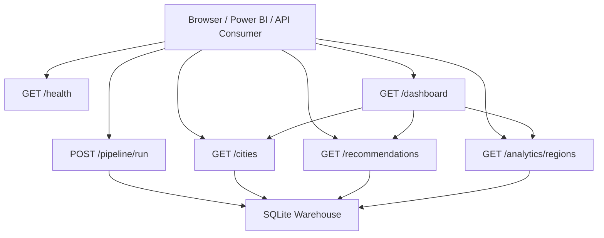
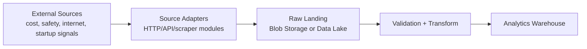
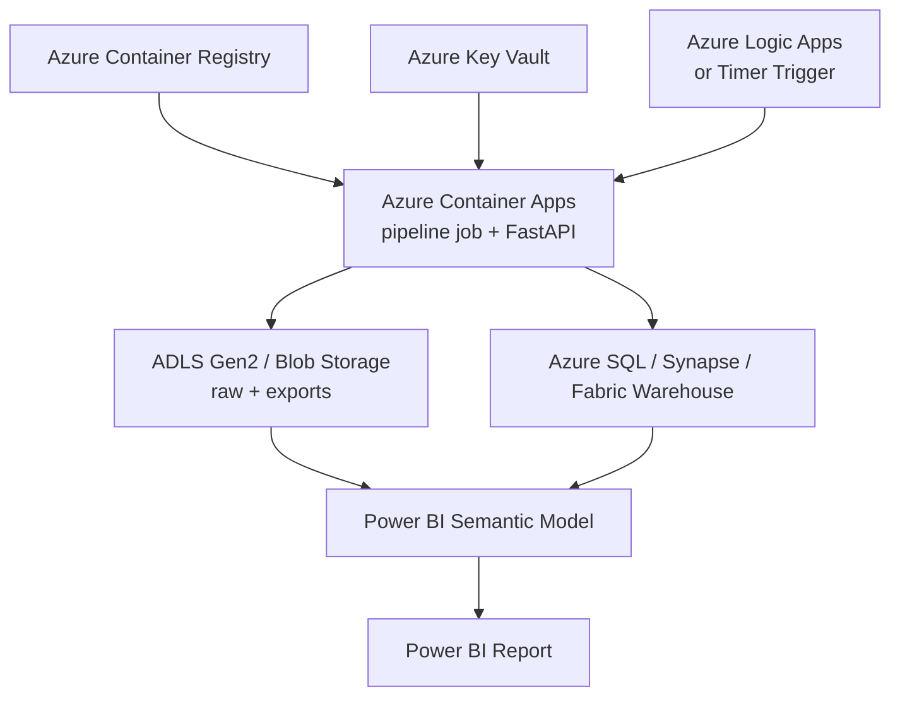
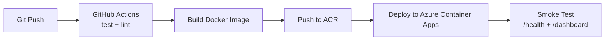

# Dev Notes

## What We Built So Far

This repo now contains a working MVP for the Startup City Data Pipeline project.

- FastAPI app with health, pipeline trigger, city metrics, recommendations, region analytics, and dashboard routes.
- Deterministic demo collector that generates cost-of-living, quality-of-life, startup, and remote-work metrics for a 220-city catalog.
- Transformation layer that calculates affordability, livability, opportunity, and overall recommendation scores.
- Local SQLite warehouse at `data/cities.sqlite3`.
- CSV exports for dashboarding at `exports/city_metrics.csv` and `exports/city_recommendations.csv`.
- Screenshot-friendly dashboard at `/dashboard`.
- Live Teleport source mode for public urban-area quality-of-life scores.
- Power BI model notes in `docs/powerbi_model.md`.
- Snowflake starter schema in `sql/snowflake_schema.sql`.
- Docker, docker-compose, Makefile, tests, linting, and GitHub Actions CI.

## Current Architecture



## Pipeline Flow



## API Surface



## Local Commands

```bash
make install
make test
make run
make api
```

Or manually:

```bash
python -m app.cli --limit 220
uvicorn app.main:app --reload
```

Useful local URLs:

- `http://127.0.0.1:8000/dashboard`
- `http://127.0.0.1:8000/docs`
- `http://127.0.0.1:8000/recommendations?limit=10`
- `http://127.0.0.1:8000/analytics/regions`

## Next Steps: Azure, Power BI, and Cloud

### 1. Expand Real Data Sources

- Teleport is now integrated as the first real public data source.
- Keep expanding source adapters under `app/pipeline/`.
- Use public APIs, downloadable datasets, or compliant scraping targets.
- Store source metadata, scrape timestamp, and raw payload references.
- Add retry/backoff and source-specific validation.

Current live source:

- Teleport urban areas list: `https://api.teleport.org/api/urban_areas/`
- Teleport urban-area scores: `https://api.teleport.org/api/urban_areas/slug:{slug}/scores/`
- Local run command: `python -m app.cli --source teleport --limit 50`

Target shape:



### 2. Move Storage to Azure

Recommended Azure MVP:

- Azure Blob Storage or ADLS Gen2 for raw files and CSV exports.
- Azure SQL Database for relational serving tables, or Azure Synapse/Fabric Warehouse for analytics.
- Azure Key Vault for API keys and connection strings.
- Azure Container Apps or Azure App Service for the FastAPI API.
- Azure Container Registry for Docker image storage.

Cloud target:



### 3. Connect Power BI

Practical options:

- Fastest: import `exports/city_metrics.csv` and `exports/city_recommendations.csv`.
- Better: publish CSVs to Azure Blob Storage and connect Power BI to Blob Storage.
- Production: load tables into Azure SQL, Synapse, or Fabric Warehouse and connect Power BI directly.

Power BI model:

- `city_metrics` joins to `city_recommendations` on `city` and `country`.
- Use `city_metrics` for operational metrics.
- Use `city_recommendations` for ranking and scoring visuals.
- Create measures for average score, city count, average cost index, and average remote score.

### 4. Add Orchestration

Good cloud scheduling paths:

- Azure Container Apps Jobs for scheduled pipeline execution.
- Azure Functions Timer Trigger for lightweight scheduled ingestion.
- GitHub Actions scheduled workflow for a simple portfolio deployment.
- Azure Data Factory if the project needs more enterprise-style orchestration.

### 5. Add CI/CD Deployment

Suggested deployment flow:



### 6. Productionize the Data Model

- Add `dim_city`, `dim_country`, `fact_city_metric_snapshot`, and `fact_city_recommendation` tables.
- Keep historical snapshots instead of replacing all rows.
- Add data quality checks for missing values, impossible ranges, and duplicate city snapshots.
- Add dbt models if using Synapse, Fabric Warehouse, Snowflake, or BigQuery.

### 7. Portfolio Polish

- Add screenshots to the README.
- Add an architecture section with one Mermaid diagram.
- Deploy `/dashboard` publicly.
- Add a short "Data Caveat" note explaining that demo metrics are synthetic until real source adapters are connected.
- Record a 30-second demo showing pipeline run, API docs, dashboard, and Power BI import.
